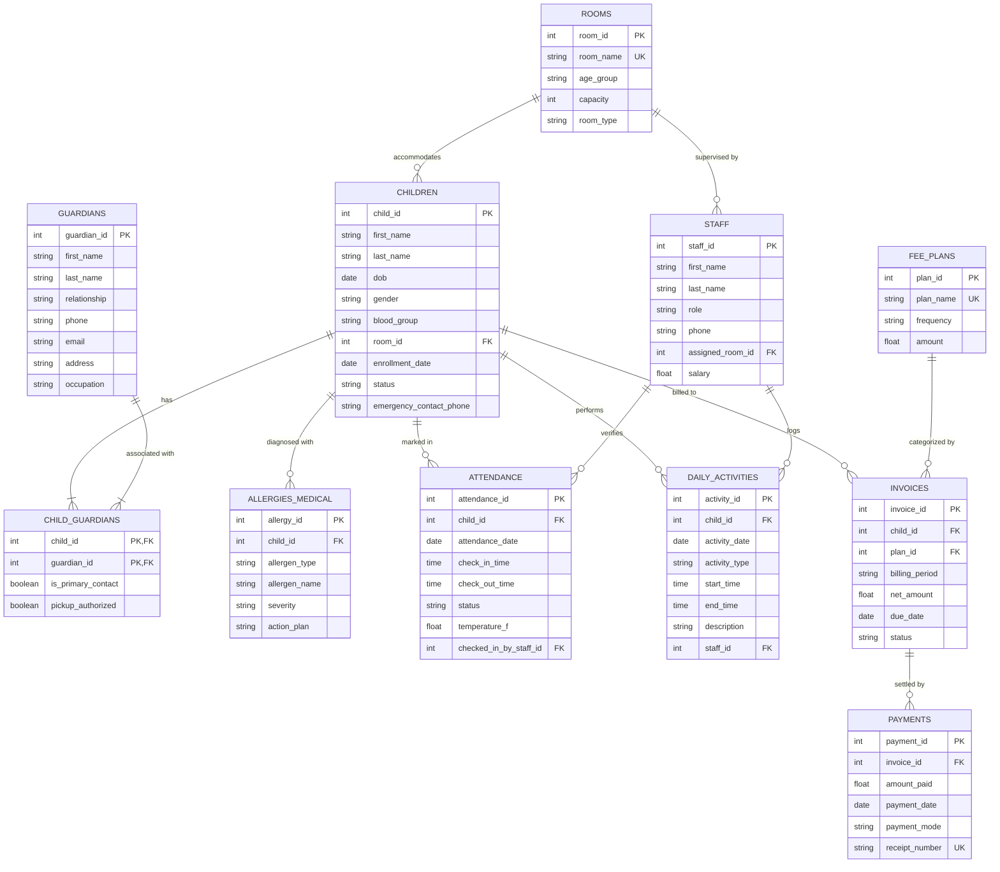

# DATABASE MANAGEMENT SYSTEMS (DBMS) MINI PROJECT REPORT

---

# **EARLYROOTS: DAYCARE & CRECHE MANAGEMENT SYSTEM**

**Course:** Database Management Systems (DBMS) Laboratory  
**Topic:** Daycare / Creche Management System  
**Brand Identity:** EarlyRoots (🌱)  
**Technology Stack:**
- **Frontend:** HTML5, CSS3 (Indian Warm Palette), JavaScript (Vanilla ES6, Fetch API)
- **Backend:** Python 3 (Flask RESTful Web Framework)
- **Database Engine:** MySQL / MariaDB (InnoDB) & SQLite3 Embedded Engine
- **Currency:** Indian Rupee (₹ INR)
- **Core DBMS Concepts:** Relational Integrity Constraints (PK/FK), Normalization (1NF to 3NF/BCNF), Multi-Table JOINs, Virtual Views, Automated Triggers, Stored Procedures, ACID Transactions, and Audit Logging.

---

## 1. ABSTRACT

Modern early childhood development centers and daycare creches in India require meticulous record management to ensure child safety, real-time parent communication, regulatory compliance, and transparent financial billing. Traditional paper-based registers or disjointed spreadsheets often suffer from data redundancy, inconsistent updates, loss of critical allergy records, and lack of referential integrity.

This project, titled **"EarlyRoots: Daycare & Creche Management System"**, presents a relational database solution engineered to centralize nursery and playgroup operations. The system systematically models children, parents/guardians, certified educators, classrooms with strict capacity thresholds (such as *Shishu Vatika*, *Nanhe Kadam*, *Bal Vatika*, and *Tarang Prep*), daily attendance registers, nutrition/nap activity tracking (such as Khichdi, Idli, and ragi meal schedules), and monthly tuition billing in Indian Rupees (₹). 

By enforcing rigorous DBMS principles—such as Third Normal Form (3NF) relational decomposition, foreign key cascade/restrict integrity, automated database triggers for overfill prevention and payment status synchronization, parameterized stored procedures, and complex SQL views—the application delivers a tamper-resistant, ACID-compliant, and high-performance management architecture paired with an intuitive, culturally warm web interface.

---

## 2. PROBLEM STATEMENT & OBJECTIVES

### 2.1 Problem Statement
Daycares handle sensitive medical alerts, emergency pickup authorizations, and dynamic schedules. Without a formal relational database management system:
1. **Medical and Allergy Risks:** An unlinked allergen or missing medical alert can endanger a child's life.
2. **Classroom Overfill Violations:** Daycare licensing laws mandate strict child-to-caregiver ratios. Unchecked registrations result in regulatory penalties.
3. **Billing Discrepancies:** Manual payment calculation across multi-tiered fee plans leads to revenue leakage and uncollected balances.
4. **Lack of Auditability:** Absence of transactional mutation logging leaves administrators blind to record alterations.

### 2.2 System Objectives
- **Integrity & Safety:** Ensure that every child record is tied to verified guardians and immediate emergency contacts with explicit pickup authorizations.
- **Relational Normalization:** Eliminate data anomalies (insertion, deletion, and update anomalies) by structuring data into 3NF.
- **Automated Business Rules via SQL Triggers:**
  - Enforce room capacity constraints prior to enrollment (`BEFORE INSERT`).
  - Automatically update invoice payment statuses and balances upon receipt insertion (`AFTER INSERT`).
  - Maintain an immutable audit trail (`audit_logs`) of student movements and transactions.
- **Reporting via Database Views:** Supply instant analytical summaries for room occupancy, attendance counts, and overdue debts without costly manual queries.
- **Interactive Evaluation Console:** Enable evaluators and database administrators to run custom and preset SQL queries with dynamic schema inspection.

---

## 3. USER ROLES & SYSTEM REQUIREMENTS

### 3.1 User Roles
1. **Daycare Administrator:** Manages room assignments, sets fee plans, monitors revenue collection, reviews audit logs, and registers staff.
2. **Lead Educator / Caregiver:** Marks daily attendance, logs meals, naps, educational milestones, and reviews child allergy profiles.
3. **Medical Nurse:** Maintains immunization, allergy records, and special medical action plans.
4. **Parent / Guardian:** Verified individuals authorized for communication, invoice settlement, and child pickup.

### 3.2 Functional Requirements
- **FR1 (Child Enrollment):** Register child personal details, assign to appropriate age-specific room, link primary guardian.
- **FR2 (Allergy Management):** Record allergen type, severity (Mild, Moderate, Severe), and medical emergency action plans.
- **FR3 (Daily Attendance):** Log daily check-in, check-out timestamps, morning body temperatures, and status (Present, Late, Absent, Excused).
- **FR4 (Activity Feed):** Record feeding logs, naps, learning play, potty intervals, and incident alerts.
- **FR5 (Tuition Billing & Payments):** Generate monthly tuition invoices and record payments with instant receipt numbers.
- **FR6 (Live SQL Explorer):** Execute ad-hoc queries, test views, and verify relational constraints.

---

## 4. ENTITY-RELATIONSHIP (ER) MODEL

### 4.1 Entities & Attributes
- **ROOMS:** `room_id` (PK), `room_name`, `age_group`, `capacity`, `room_type`
- **STAFF:** `staff_id` (PK), `first_name`, `last_name`, `role`, `phone`, `email`, `qualification`, `assigned_room_id` (FK), `hire_date`, `salary`
- **CHILDREN:** `child_id` (PK), `first_name`, `last_name`, `dob`, `gender`, `blood_group`, `room_id` (FK), `enrollment_date`, `status`, `emergency_contact_phone`, `notes`
- **GUARDIANS:** `guardian_id` (PK), `first_name`, `last_name`, `relationship`, `phone`, `email`, `address`, `occupation`
- **CHILD_GUARDIANS:** `child_id` (PK, FK), `guardian_id` (PK, FK), `is_primary_contact`, `pickup_authorized`
- **ALLERGIES_MEDICAL:** `allergy_id` (PK), `child_id` (FK), `allergen_type`, `allergen_name`, `severity`, `action_plan`
- **ATTENDANCE:** `attendance_id` (PK), `child_id` (FK), `attendance_date`, `check_in_time`, `check_out_time`, `status`, `temperature_f`, `checked_in_by_staff_id` (FK), `remarks`
- **DAILY_ACTIVITIES:** `activity_id` (PK), `child_id` (FK), `activity_date`, `activity_type`, `start_time`, `end_time`, `description`, `staff_id` (FK)
- **FEE_PLANS:** `plan_id` (PK), `plan_name`, `description`, `frequency`, `amount`
- **INVOICES:** `invoice_id` (PK), `child_id` (FK), `plan_id` (FK), `billing_period`, `total_amount`, `discount_amount`, `net_amount`, `due_date`, `status`
- **PAYMENTS:** `payment_id` (PK), `invoice_id` (FK), `amount_paid`, `payment_date`, `payment_mode`, `transaction_ref`, `receipt_number`
- **AUDIT_LOGS:** `log_id` (PK), `action_type`, `table_name`, `record_id`, `details`, `created_at`

### 4.2 Mermaid Entity-Relationship Diagram



---

## 5. DATABASE NORMALIZATION BREAKDOWN

A pivotal academic benchmark of any DBMS project is ensuring zero anomalies through normalization.

### 5.1 Unnormalized Form (UNF) Anomalies
In an unnormalized daycare spreadsheet, a single row typically contains:
`ChildName, DOB, GuardianNames, GuardianPhones, Allergies, RoomName, RoomCapacity, AttendanceDates, InvoiceAmount, Payments`
- **Insertion Anomaly:** Cannot create a classroom without enrolling a child. Cannot record a guardian without a child.
- **Deletion Anomaly:** Deleting a child record accidentally wipes out room definitions and payment history.
- **Update Anomaly:** Updating a parent's phone number requires updating hundreds of past attendance entries; failure to update all leads to inconsistency.

### 5.2 First Normal Form (1NF)
**Condition:** Each column must hold atomic (indivisible) values, and there must be no repeating groups or multi-valued attributes.
- **Decomposition:**
  - Multi-valued guardians were split into an independent `guardians` table and linked via the `child_guardians` junction table.
  - Multi-valued allergies were decoupled into `allergies_medical`.
  - Child names were atomized into `first_name` and `last_name`.

### 5.3 Second Normal Form (2NF)
**Condition:** The relation must be in 1NF, and every non-prime attribute must be **fully functionally dependent** on the candidate key (no partial dependency on composite primary keys).
- **Proof in `child_guardians`:**
  - Composite Primary Key = `{child_id, guardian_id}`.
  - Non-prime attributes: `is_primary_contact`, `pickup_authorized`.
  - `is_primary_contact` depends on **both** `{child_id, guardian_id}` (a parent may be the primary contact for Child A, but secondary for Child B).
  - Guardian attributes (`address`, `occupation`, `phone`) depend **only** on `guardian_id`. Hence, they reside in `guardians`, completely eliminating partial functional dependency.

### 5.4 Third Normal Form (3NF)
**Condition:** The relation must be in 2NF, and no non-prime attribute must be transitively dependent on the primary key ($X \rightarrow Y$ and $Y \rightarrow Z$, where $X$ is PK).
- **Tuition & Invoicing Decomposition:**
  - If `invoices` had `plan_name` and `amount`, we would have:
    $$\text{invoice\_id} \rightarrow \text{plan\_id} \rightarrow \text{base\_amount}$$
  - This is a transitive dependency.
  - **Resolution:** Created a separate `fee_plans` entity with Candidate Key `plan_id`. The `invoices` relation retains only foreign key `plan_id`.
- **Rooms & Children Decomposition:**
  - `child_id` $\rightarrow$ `room_id` $\rightarrow$ `room_capacity, age_group`.
  - **Resolution:** Retained room details in the normalized `rooms` table.

### 5.5 Boyce-Codd Normal Form (BCNF)
For every functional dependency $X \rightarrow Y$ in all relations, $X$ is a superkey. All tables strictly satisfy BCNF.

---

## 6. RELATIONAL INTEGRITY CONSTRAINTS & REFERENTIAL ACTIONS

| Parent Table | Child Table | Foreign Key Column | ON DELETE | ON UPDATE | Rationale |
| :--- | :--- | :--- | :--- | :--- | :--- |
| `rooms` | `children` | `room_id` | **RESTRICT** | CASCADE | Prevents accidental deletion of a room while children are enrolled in it. |
| `rooms` | `staff` | `assigned_room_id` | **SET NULL** | CASCADE | If a room is closed, staff assignment becomes NULL without deleting staff. |
| `children` | `child_guardians` | `child_id` | **CASCADE** | CASCADE | Deleting a child cleans up relational links automatically. |
| `guardians` | `child_guardians` | `guardian_id`| **CASCADE** | CASCADE | Deleting a guardian purges corresponding link records. |
| `children` | `allergies_medical`| `child_id` | **CASCADE** | CASCADE | Medical alerts pertain strictly to that child. |
| `children` | `attendance` | `child_id` | **CASCADE** | CASCADE | Child withdrawal removes attendance register rows. |
| `invoices` | `payments` | `invoice_id` | **CASCADE** | CASCADE | Payment transaction ledger cascade links with invoice. |
| `fee_plans` | `invoices` | `plan_id` | **RESTRICT** | CASCADE | A fee category with issued bills cannot be deleted. |

---

## 7. DATABASE IMPLEMENTATION: VIEWS, TRIGGERS & PROCEDURES

### 7.1 Database Views (Virtual Relations)
1. **`view_children_directory`**: Combines student demographics, classroom names, primary guardian details, and total allergy alerts using multi-table LEFT JOINs.
2. **`view_room_summary`**: Computes enrolled headcount, available capacity slots, and percentage occupancy using `GROUP BY` and arithmetic expressions.
3. **`view_pending_dues`**: Financial view aggregating total payments against invoice totals to display outstanding balances and parent contact details.
4. **`view_daily_attendance_today`**: Supplies an active status matrix of check-in, check-out, and body temperature metrics for today's date.
5. **`view_daily_activity_feed`**: Chronological event feed combining meals, naps, and caregiver remarks.

### 7.2 Database Triggers
- **`trg_enforce_room_capacity` (BEFORE INSERT on `children`):**
  Checks whether `COUNT(*) WHERE room_id = NEW.room_id AND status = 'Active'` is greater than or equal to `rooms.capacity`. If capacity is reached, issues `SIGNAL SQLSTATE '45000'` (or `RAISE(ABORT)` in SQLite) to block overfill.
- **`trg_payment_update_invoice` (AFTER INSERT on `payments`):**
  Calculates `SUM(amount_paid)` for `NEW.invoice_id`. If total paid equals or exceeds `net_amount`, updates `invoices.status = 'Paid'`. Otherwise, sets status to `'Partially Paid'`. Automatically writes an entry to `audit_logs`.
- **`trg_child_audit_insert` (AFTER INSERT on `children`):**
  Logs new child registrations into `audit_logs` with child ID, room ID, and timestamp.
- **`trg_child_audit_update` (AFTER UPDATE on `children`):**
  Tracks student status transitions (e.g., Active to Graduated/Withdrawn) in `audit_logs`.

### 7.3 Stored Procedures
- **`sp_EnrollChild`**: Performs an atomic enrollment transaction: inserts child, links primary guardian, and initializes student state.
- **`sp_RecordPayment`**: Processes payment amount, generates a standardized receipt token (`REC-YYMMDD-XXXX`), updates invoice balance, and commits transaction.
- **`sp_GetDailyAttendanceSummary`**: Computes aggregated counts of Present, Absent, Late, and Excused children grouped by classroom.
- **`sp_GetChildFullProfile`**: Multi-result set procedure fetching demographics, emergency contacts, allergy alerts, and billing totals for an individual child.

---

## 8. COMPLEX SQL QUERIES (DEMONSTRATION & VIVA)

### Query 1: 4-Way Relational JOIN
```sql
SELECT 
    c.child_id,
    CONCAT(c.first_name, ' ', c.last_name) AS student_name,
    r.room_name,
    CONCAT(g.first_name, ' ', g.last_name) AS guardian_name,
    fp.plan_name,
    fp.amount AS monthly_tuition
FROM children c
INNER JOIN rooms r ON c.room_id = r.room_id
LEFT JOIN child_guardians cg ON c.child_id = cg.child_id AND cg.is_primary_contact = 1
LEFT JOIN guardians g ON cg.guardian_id = g.guardian_id
LEFT JOIN invoices inv ON c.child_id = inv.child_id
LEFT JOIN fee_plans fp ON inv.plan_id = fp.plan_id
WHERE c.status = 'Active';
```
*Concept Illustrated:* Combining 4 tables (`children`, `rooms`, `guardians`, `fee_plans`) using both `INNER JOIN` and `LEFT JOIN` to construct a unified student directory.

---

### Query 2: Aggregate Function with GROUP BY and HAVING
```sql
SELECT 
    r.room_id,
    r.room_name,
    r.capacity AS max_limit,
    COUNT(c.child_id) AS total_enrolled,
    ROUND((COUNT(c.child_id) * 100.0 / r.capacity), 2) AS occupancy_pct
FROM rooms r
LEFT JOIN children c ON r.room_id = c.room_id AND c.status = 'Active'
GROUP BY r.room_id, r.room_name, r.capacity
HAVING COUNT(c.child_id) > 0
ORDER BY occupancy_pct DESC;
```
*Concept Illustrated:* Mathematical ratio computation, grouping by primary key and non-aggregate attributes, filtered via `HAVING`.

---

### Query 3: Nested Subquery with Comparison Operator
```sql
SELECT 
    i.invoice_id,
    CONCAT(c.first_name, ' ', c.last_name) AS child_name,
    i.billing_period,
    i.net_amount
FROM invoices i
JOIN children c ON i.child_id = c.child_id
WHERE i.net_amount > (
    SELECT AVG(net_amount) 
    FROM invoices
);
```
*Concept Illustrated:* Dynamic scalar subquery comparing individual record values against the global statistical average.

---

### Query 4: Correlated Subquery with `EXISTS`
```sql
SELECT 
    c.child_id,
    CONCAT(c.first_name, ' ', c.last_name) AS child_name,
    c.blood_group,
    c.emergency_contact_phone
FROM children c
WHERE EXISTS (
    SELECT 1 
    FROM allergies_medical a
    WHERE a.child_id = c.child_id 
      AND a.severity = 'Severe'
);
```
*Concept Illustrated:* Correlated subquery evaluating an existence predicate (`EXISTS`) across foreign key references.

---

### Query 5: Set Operation (`UNION`)
```sql
SELECT 
    CONCAT(c.first_name, ' ', c.last_name) AS child_name,
    CONCAT(g.first_name, ' ', g.last_name) AS contact_person,
    g.phone AS contact_number,
    'Primary Guardian' AS contact_role
FROM children c
JOIN child_guardians cg ON c.child_id = cg.child_id AND cg.is_primary_contact = 1
JOIN guardians g ON cg.guardian_id = g.guardian_id

UNION

SELECT 
    CONCAT(c.first_name, ' ', c.last_name) AS child_name,
    'Daycare Emergency Registry' AS contact_person,
    c.emergency_contact_phone AS contact_number,
    'Direct Registry Record' AS contact_role
FROM children c;
```
*Concept Illustrated:* Set-theoretic union combining records from distinct relational paths while eliminating duplicates.

---

## 9. UNIVERSITY DBMS VIVA VOCE QUESTIONS & ANSWERS

**Q1: What is the primary difference between a Primary Key and a Unique Key?**  
*Answer:* A Primary Key uniquely identifies each tuple in a relation, enforces entity integrity, and cannot accept NULL values. A Unique Key enforces column uniqueness but permits NULL values (once in SQL standard, depending on DBMS implementation). A table can have only one Primary Key, but multiple Unique keys.

**Q2: What is Referential Integrity and how is it enforced in this project?**  
*Answer:* Referential integrity guarantees that a foreign key value in a child table must always correspond to an existing candidate key value in the referenced parent table. In TinySteps, it is enforced using `FOREIGN KEY (...) REFERENCES ...` with strict referential actions such as `ON DELETE RESTRICT` (preventing classroom deletion if children are enrolled) and `ON DELETE CASCADE` (purging linked attendance when a child is deleted).

**Q3: Explain the difference between `WHERE` and `HAVING` clauses.**  
*Answer:* The `WHERE` clause filters individual rows *before* aggregation occurs, and cannot accept aggregate functions. The `HAVING` clause filters aggregated groups *after* `GROUP BY` execution, and operates directly on aggregate expressions (e.g., `HAVING COUNT(c.child_id) > 1`).

**Q4: What is a Database Trigger and what types did you implement?**  
*Answer:* A trigger is a declarative stored procedural block executed automatically in response to specified DML events (`INSERT`, `UPDATE`, `DELETE`) on a particular table. We implemented:
1. `BEFORE INSERT`: Room capacity constraint trigger (`trg_enforce_room_capacity`) which validates capacity limits and aborts the insert if full.
2. `AFTER INSERT`: Payment synchronization trigger (`trg_payment_update_invoice`) that auto-updates invoice status to 'Paid' or 'Partially Paid' and records the mutation in `audit_logs`.

**Q5: What are the ACID properties in database transactions?**  
*Answer:*
- **Atomicity:** All operations within a transaction succeed together or are rolled back completely (e.g., child enrollment + guardian linking in `sp_EnrollChild`).
- **Consistency:** Database transitions from one valid state satisfying all schema constraints to another.
- **Isolation:** Concurrent transactions execute without cross-contamination.
- **Durability:** Once committed, transaction results survive system crashes and hardware restarts.

**Q6: What is a Database View and why is it used?**  
*Answer:* A view is a virtual table defined by a saved SQL query. It does not store physical data itself (unless materialized). Views provide:
1. **Security:** Restricting direct access to sensitive columns (e.g., staff salaries).
2. **Simplicity:** Abstracting complex multi-table joins and calculations into a single clean relation.
3. **Consistency:** Centralizing business logic calculations (e.g., occupancy percentage calculation).

**Q7: Explain the 3rd Normal Form (3NF) with respect to your project.**  
*Answer:* A relation is in 3NF if it is in 2NF and contains no transitive functional dependencies ($X \rightarrow Y$ and $Y \rightarrow Z$, where $X$ is PK and $Z$ is non-prime). In our system, if tuition fees were stored directly in `invoices`, `invoice_id` would determine `plan_id`, which in turn determines `amount`. We eliminated this transitive dependency by isolating tuition rates into `fee_plans`.

---

## 10. CONCLUSION & FUTURE SCOPE

The **TinySteps Daycare & Creche Management System** bridges foundational database theory with real-world institutional operations. By structuring schemas into 3NF, embedding business logic in database triggers, encapsulating procedures, and surfacing analytical views, the project guarantees complete data integrity, safety verification, and transparent accounting.

### Future Scope:
- Biometric fingerprint / RFID gate integration directly interfacing with the `attendance` table.
- Mobile push notifications sent to parents triggered by insertions in `daily_activities`.
- Automated PDF invoice receipt generation and payment gateway webhook listeners.
